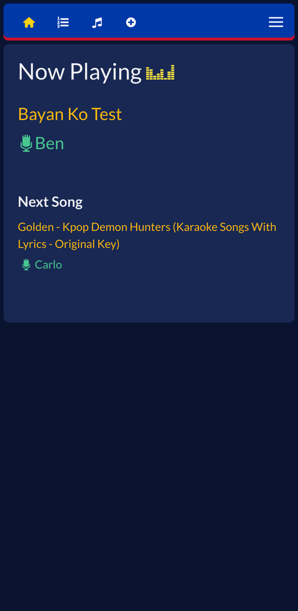
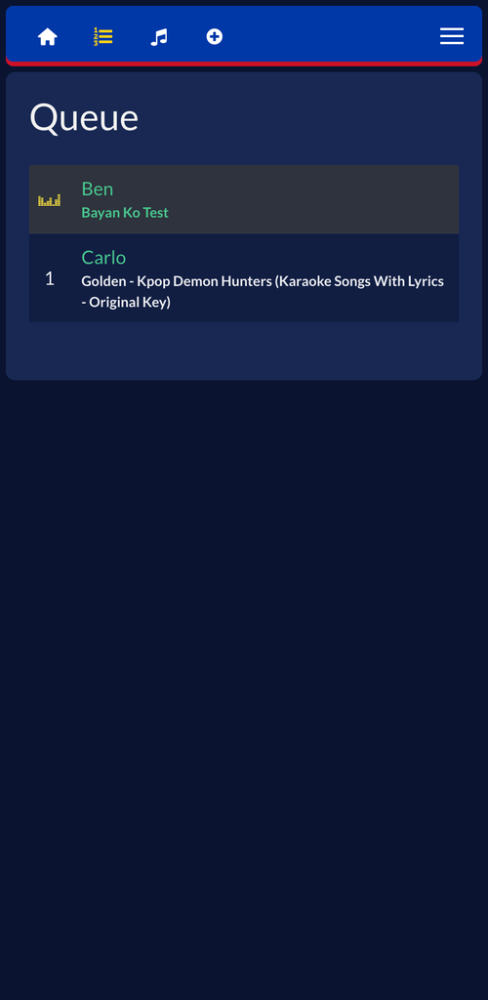
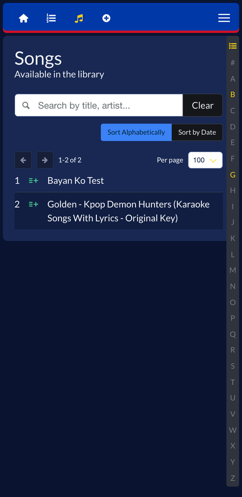
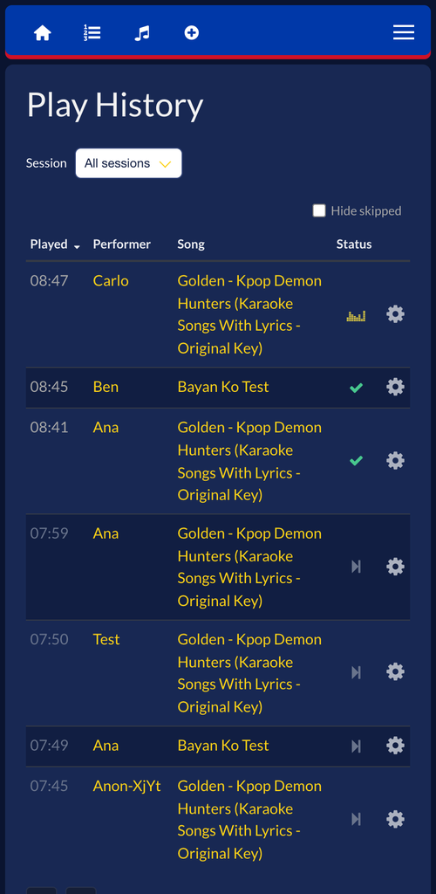
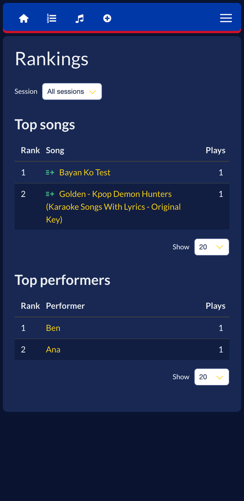

# Karaoke ni Lakay


Karaoke ni Lakay is a cross-platform karaoke server, dressed in the colors of the Philippine flag, that brings the "KTV" experience to your home. It transforms your computer or Raspberry Pi into a dedicated karaoke station with a full-screen player and an instant web interface. Guests can join by simply scanning a QR code—no app downloads required—to browse your local library, manage the queue, and access countless karaoke hits from YouTube.

Karaoke ni Lakay is a fork of [PiKaraoke](https://github.com/vicwomg/pikaraoke) by Vic Wong. The program is still installed and run as `pikaraoke`, as shown below.

- 📱 Instant Mobile Remote: Search and queue songs from any smartphone—just scan and sing.
- 📺 Dedicated Player: High-performance splash screen that can be opened on any web browser for a true karaoke room feel.
- 🌐 YouTube & Local Media: Play your own files or access more from the web.
- 🎹 Live Pitch Shifting: Adjust the key of any song to match your vocal range.
- 🛠️ Admin Control: Manage the queue and settings via a password-protected admin mode.
- 📊 Session Management: Every night is recorded automatically—browse the play history, then see which songs and performers topped the charts.
- 🎯 Hyper-accurate vocal performance scoring system: (not really, it's random. But kind of fun!)
- 🐧 Lightweight & Versatile: Runs anywhere from a basic Raspberry Pi to a high-end PC.

[](https://conventionalcommits.org)

## Table of Contents

- [Supported Devices / OS / Platforms](#supported-devices--os--platforms)
- [Quick Install](#quick-install)
- [Manual Installation](#manual-installation-advanced-users)
- [Usage](#usage)
- [Docker](#docker-instructions)
- [Hosting venues](#hosting-venues-karaoke-ni-lakay-cloud)
- [Screenshots](#screenshots)
- [Developing](#developing)

## Supported Devices / OS / Platforms

- OSX
- Windows
- Linux
- Raspberry Pi 4 or higher (Pi3 works ok with overclocking)

## Quick Install

For a streamlined installation that handles all dependencies (uv, ffmpeg, deno) and installs Karaoke ni Lakay, run the following in your terminal:

### Linux & macOS

```sh
curl -fsSL https://raw.githubusercontent.com/christopherece/pikaraoke/master/build_scripts/install/install.sh | bash
```

### Windows (installer)

Download `Karaoke-ni-Lakay-<version>-setup.exe` from the [latest release](https://github.com/christopherece/pikaraoke/releases) and run it. It adds Start Menu and desktop shortcuts.

Windows shows a blue "Windows protected your PC" screen because the installer is unsigned. Click **More info**, then **Run anyway**.

To uninstall, use **Settings > Apps**.

### Windows (PowerShell)

```powershell
irm https://raw.githubusercontent.com/christopherece/pikaraoke/master/build_scripts/install/install.ps1 | iex
```

To uninstall, swap `install.ps1` for `uninstall.ps1`.

After installation, you can launch Karaoke ni Lakay from the command line with `pikaraoke` or from a desktop shortcut. Re-running the above command updates it to the latest version.

Uninstalling removes the app and its shortcuts. Your songs, settings, ffmpeg, deno and uv are left in place.

## Manual installation (advanced users)

### Prerequisites

- A modern web browser (Chrome/Chromium/Edge recommended)
- Python 3.10 or greater: [Python downloads](https://www.python.org/downloads/)
- FFmpeg (preferably a build with lib-rubberband for transposing): [FFmpeg downloads](https://ffmpeg.org/download.html)
- A js runtime installed to your PATH. [Node.js](https://nodejs.org/en/download/) is most common, [Deno](https://deno.com/) is probably easiest for non-developers.

### Install the app

We recommend installing it with [uv](https://github.com/astral-sh/uv), straight from this repository. (The `pikaraoke` package on PyPI is the upstream project, without Karaoke ni Lakay's changes.)

```sh
uv tool install git+https://github.com/christopherece/pikaraoke
```

## Usage

Run it from the command line with:

```sh
pikaraoke
```

Launches the player in "headed" mode via your default browser. Scan the QR code to connect mobile remotes. Use `pikaraoke --headless` to run as a background server for external browsers.

See the help command `pikaraoke --help` for available options.

To upgrade to the latest version, run:

```sh
uv tool install --force git+https://github.com/christopherece/pikaraoke
```

## Docker instructions

Karaoke ni Lakay ships a `docker-compose.yml` that builds the image from this repository (the upstream image on Docker Hub does not include Karaoke ni Lakay's changes):

```sh
git clone https://github.com/christopherece/pikaraoke.git karaoke-ni-lakay
cd karaoke-ni-lakay
cp .env.example .env    # set KNL_URL to http://<YOUR_LAN_IP>:5555
mkdir -p songs data     # create before first start so the container can write to them
docker compose up -d --build
```

`KNL_URL` is the address shown in the QR code; a container cannot see the host's LAN IP, so it must be set. `.env` also sets the published port, the timezone (`TZ`, default `Asia/Manila`, from the "TZ identifier" column of the [tz database list](https://en.wikipedia.org/wiki/List_of_tz_database_time_zones)), and the host folders for songs and app data. To update, `git pull` and run `docker compose up -d --build` again.

To pass a path prefix or other options, extend `command` in `docker-compose.yml`. To run under a path prefix (e.g., `/karaoke`), add `--base-path /your-path` and set `-u` to the public origin. Example: `--base-path /karaoke -u https://example.com`. Karaoke ni Lakay will generate links under `/karaoke` automatically. For reverse proxy setups, the proxy must forward both HTTP and WebSocket traffic for that path to Karaoke ni Lakay. Path-based nginx-proxy setups typically also need `VIRTUAL_PATH=/karaoke` with `VIRTUAL_DEST=/`.

## Hosting venues (Karaoke ni Lakay Cloud)

[`cloud/`](../cloud) runs Karaoke ni Lakay as a subscription service: one server hosts many venues, each at its own web address with its own songs, queue and admin password, and an owner page manages them.

- **Owner page** at `owner.<your domain>`: add a venue (name, web address, plan, free-trial length, admin password), see each venue's plan, trial end, paid-until date, song storage, last song played and whether its container is running, and record payments with **✓ Paid 1 month** / **✓ Paid 1 year**.
- **Plans** limit song storage: Small (5 GB, about a hundred songs), Medium (15 GB), Large (no limit). Change them in `PLANS` in [`cloud/owner.py`](../cloud/owner.py). A venue that reaches its limit can still sing everything it has, but cannot download more.
- **Trial and payments:** a venue sees a warning banner in the last 7 days of its trial, and for 7 days after its paid-until date passes. After that it turns **read-only**: everyone can still browse the library and history and the host can still log in, but nothing can be queued or downloaded. The owner can also make a venue read-only, or turn it back on, at any time.
- Each venue's host sees its plan and storage under **Settings › System Info**.

Each venue runs in its own container (`knl-<venue>`), started by the owner app, and [Traefik](https://traefik.io/) routes `<venue>.<your domain>` to it. Songs are video files, so disk space and the bandwidth of streaming to every venue's TV are what a server runs out of first; the owner page shows free disk space.

### Try it on your computer

```sh
cd cloud
cp .env.example .env
```

In `.env` set `BASE_DOMAIN=localhost`, an `OWNER_PASSWORD`, `HOST_DATA_DIR` to an absolute path (e.g. the full path of `cloud/data`), `PUBLIC_SCHEME=http` and `PUBLIC_PORT=8088`. Then:

```sh
mkdir -p data
docker compose up -d --build
```

Open **http://owner.localhost:8088**, log in and add a venue, e.g. `lakaybar`. It is then at **http://lakaybar.localhost:8088** (Chrome and Edge open `*.localhost` addresses without any setup).

### Running it on a server (DigitalOcean droplet)

1. **DNS:** point `owner.yourdomain.com` and `*.yourdomain.com` (a wildcard A record) at the droplet's IP.
2. **Start it:** in `cloud/`, `cp .env.example .env`, set `BASE_DOMAIN=yourdomain.com`, `OWNER_PASSWORD`, `OWNER_CONTACT`, `HOST_DATA_DIR` (e.g. `/opt/karaoke-cloud/data`) and `HTTP_BIND=172.17.0.1:8088`, then `mkdir -p` the data directory and `docker compose up -d --build`.
3. **HTTPS with Nginx Proxy Manager:** add one proxy host for `owner.yourdomain.com` and `*.yourdomain.com` (a wildcard certificate needs Let's Encrypt's DNS challenge), forwarding to `http://172.17.0.1:8088`. Turn on Websockets Support, request an SSL certificate with Force SSL, and add `proxy_read_timeout 120s; proxy_buffering off;` under Advanced so the queue and player stay connected.

To update, `git pull` and run `docker compose up -d --build` again: the owner app moves every venue onto the new image as it starts.

Everything lives in `HOST_DATA_DIR`: `owner.json` (venues, plans, dates), `owner.key` (owner logins) and one folder per venue under `venues/`, holding its songs and data. Back it up.

## Screenshots

<div style="display: flex; flex-wrap: wrap;">







</div>

## Developing

The project uses `uv` for dependency management and local development.

- Install [uv](https://github.com/astral-sh/uv)
- Git clone this repo

From the repository directory:

```sh
# install dependencies and run the app from local code
uv run pikaraoke
```

Run the tests with `uv run pytest`, and the code-quality checks with `uv run pre-commit run --config code_quality/.pre-commit-config.yaml --all-files`.
